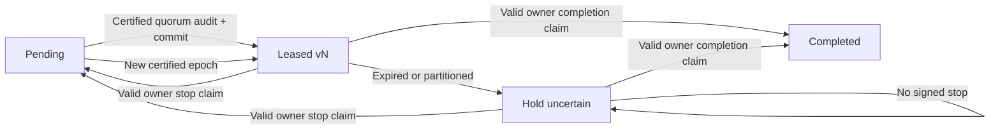

# Research Step 6 — Quorum-Fenced Dynamic Task Recovery and Bounded Lease Intents

**Date:** 2026-11-15  
**Working paper:** *Consistency-Gated Task Allocation for Decentralized UAV Swarms Under Stale and Byzantine-Falsified Telemetry*  
**Parent:** [Step 2 protocol](CONSISTENCY_GATED_STEP2_EXPERIMENTAL_PROTOCOL.md), [Step 3 method](CONSISTENCY_GATED_STEP3_ALGORITHM.md), [Step 4 threat model](CONSISTENCY_GATED_STEP4_ATTACK_FRAMEWORK.md), and [Step 5 comparison](CONSISTENCY_GATED_STEP5_BASELINE_COMPARISON.md).  
**Scope:** simulated **coordinator decision/lease recovery**; no physical UAV execution, distributed task-ledger consensus, real stop sensing, or guarantee of exactly-once actuation.

## Fundamental correctness boundary

There is **no general exactly-once physical task execution guarantee** during partitions or in the presence of malicious registered owners. A locally committed assignment does not prove that the owner executed it; a validly signed `STOPPED` or `COMPLETED` report proves reporter identity, not physical stopping or completion. An expired command lease cannot be assumed to have been enforced by the UAV.

Therefore Step 6 intentionally implements the more modest and testable contract:

1. One authoritative **locally outstanding lease per task**, strictly increasing version on every accepted reassignment.
2. No reassignment merely because the owner disappeared, the lease expired, a partition occurred, or a new leader was elected. The unresolved lease stays **EXPIRED_UNCONFIRMED / HOLD**, preserving uncertainty.
3. Reassign only after a matching **member-signed STOPPED claim** (or no prior lease). This permits availability under cooperative truthful owners; **a malicious owner can lie**, so physical non-overlap is NOT guaranteed.
4. Ignore/reject old generation, old authority epoch, another member's signature, invalid signature, future/aged observation time, duplicate and crossed-mission receipt.
5. An owner-signed `COMPLETED` claim transitions the task to a terminal coordinator state without another assignment.
6. The coordinator requires a fresh quorum-certified leader before creating an **intent**, which is audited through the existing quorum-approval journal first; it does not broadcast a flight command in this Step 6 path.

The cryptographic receipt's signed domain is `swarm-sim-task-lease-receipt-v1` and binds **mission ID, task ID, owner ID, lease generation, authority epoch, STOPPED/COMPLETED action, and observation time**. Signed receipts are modeled but do not yet travel over a real peer-to-peer transport. Signatures and local SHA-256 event-chain consistency do not provide physical attestation or Byzantine distributed consensus.

## Implementation

| File | Verified responsibility |
|---|---|
| `swarm_task_recovery.py` | `TaskRecoveryLedger`: idempotent task registration; immutable task target per ID; versioned outstanding leases; preview-then-commit with revision/digest checks; monotonic virtual time and authority-epoch fencing; Ed25519-verified owner receipts; locally hash-chained events; fail-closed expiration |
| `mesh_simulation.py` | New opt-in `plan_recovery_tasks(ledger, consistency_policy, witnesses)`: use **live certified leader**, verified peer roster, local signed health and independently tracked position freshness, existing consistency gate and quorum-audited lease intent; **no simulated drone `goto`/broadcast** |
| `test_swarm_task_recovery.py` | Lease idempotency, verified stop/completion, no automatic expiry reuse, failed-quorum rollback, forged/tampered/cross-epoch receipts, monotonic generation, leader epoch fencing, capacity, local evidence chain and real signed certificate/audit integration |
| `swarm_recovery_experiments.py` | Event-driven simulated mission failures and recovery diagnostics; per-episode transitions and raw local event hashes |
| `test_swarm_recovery_experiments.py` | Scenario outcomes, negative security cases, deterministic replay and output integrity assertions |

The recovery layer is **opt-in**, independent of the existing `command_tasks` Greedy baseline and its action delivery. It does not automatically retrofit the old flight path with lease enforcement or revocation. In particular, a simulated drone could still receive an older certified task assignment through the legacy path. The paper must not claim the Step 6 coordinator ledger alone stops that behavior.

## State machine and behavior

- `PENDING` → `LEASED` after a quorum-audited intent with version and nonexpired virtual time.
- `LEASED` remains unresolved at expiry (**expired_unconfirmed=True**); it is not cleared automatically and its owner is reserved.
- `LEASED` → `PENDING` after exact signed owner `STOPPED` acknowledgment, **assuming the signer reports truthfully**.
- `LEASED` → terminal `COMPLETED` after exact signed `COMPLETED` acknowledgment (not externally attested).
- Old-generation receipts cannot affect a newer lease. A new authority epoch cannot silently clear unresolved prior ownership.
- Recovery task selection uses the unchanged greedy allocator on authenticated/fresh, consistency-gate-accepted telemetry, and excludes owners currently reserved for other outstanding leases.



The diagram concerns **coordinator decisions**, not remotely proven execution or a distributed consensus protocol.

## Controlled recovery scenarios

1. `normal_completion`: signed completion makes the coordinator's task terminal.
2. `signed_stop_reassign`: valid owner-signed STOPPED claim releases task; version increments and different eligible owner is selected.
3. `unconfirmed_failure`: owner disappears and the lease expires; no reassignment without signed stopping proof.
4. `quorum_partition`: planning denied without fresh quorum; the old outstanding lease remains unresolved upon return.
5. `epoch_failover`: reassignment in higher authority epoch after signed stop; stale old-epoch receipt and old-leader planning rejected.
6. `forged_stop_attempt`: a different registered signer cannot impersonate the leased task owner.
7. `false_signed_stop`: compromised registered owner falsely signs STOPPED; coordinator accepts identity-authenticated claim and reassigns, **demonstrating the limits of physical exactly-once assurances**.
8. `late_stop_after_expiry`: delayed genuine STOPPED claim can release a held task (virtual times only).
9. `new_task_arrival`: dynamically registered independent task is assigned while another task remains leased.
10. `no_eligible_recovery`: a valid stop occurs but no eligible member is available, so the task remains pending.

**Sampling:** the runner's default **10 fault/mission scenarios × 2 fleet sizes × 2 seeds = 40 diagnostic episodes**, not 40 independent deployment trials. The environment uses a fixed geometry with a tiny seeded perturbation; this does not justify population-level effectiveness comparisons.

## Reproduction

```bash
python -m pytest -q test_swarm_task_recovery.py test_swarm_recovery_experiments.py

python swarm_recovery_experiments.py --sizes 5 10 --trials 2 --seed 2026 \
  --out experiment_outputs/consistency-gated-step6
```

CI uploads:

- `recovery_episodes.json`: fully raw transitions, versions, owners, simulated time, accepted/rejected receipts and locally hash-chained event records.
- `recovery_metrics.csv`: one per diagnostic episode, explicitly distinguishing absence of proof and cooperative receipt cases.
- `manifest.json`: source SHA, supported runner/environment, all exact SHA-256 hashes, scenario counts and limits of inference.

No private keys or real encrypted packet buffers are present in saved data. Existing 378-trial archive and Step 4–5 artifacts are untouched.

## Known critical limitations / mandatory future work

- **Stop truth is untrusted.** Signed old-owner acknowledgment may be false. Without trusted local lease enforcement / independent revocation confirmation / an execution protocol, neither task exclusivity in the world nor exactly-once execution is guaranteed.
- **No receiver-side version enforcement yet.** The ledger rejects stale *receipts*, while the existing `MeshRuntime` accepts certified command messages under its own epoch/crypto rules. For any physical execution claim, integrate per-task generation filtering and enforce local leases under bounded clock skew / network partitions.
- **No durable replicated state.** Locally hash-chained in-memory logs detect accidental modification, but aren't Byzantine quorum consensus, crash-safe checkpoint persistence or leader-to-leader replicated task history. After process loss, this single-writer state can disappear.
- **No end-to-end transport of receipts.** Receipts are signed and cryptographically verified in an API; no peer-to-peer ACK/drop/delay channel is implemented or benchmarked.
- **No real-world recovery-time measurements.** Experimental times are synthetic virtual timestamps. Reassignment can be unavailable under partitions by design; false-accept, false-reject and utility trade-offs need statistical evaluation.
- **No fair dynamic recovery baseline comparison yet.** Step 5 compares static allocation with ideal auctions. Recovery comparisons need equivalent task lifecycle, observation, communication and actuation assumptions.
- **No physical drone hardware or safety proof.** Only actual physical tests or a carefully modeled trusted executor can support physical stop/flight claims. This study must stay explicitly software-only.

**Step 6 stage gate:** verifiable software recovery-intent state machine and signed receipt negative controls, integrated quorum-audit-only planning, 40 diagnostic cases, regression tests, new integrity-bound artifacts and 9/9 CI. This is not journal publication readiness; full randomized independent experiments, statistical analysis and integrity audit are Steps 7–9.
