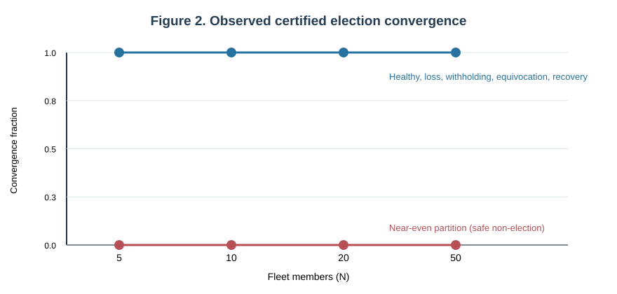
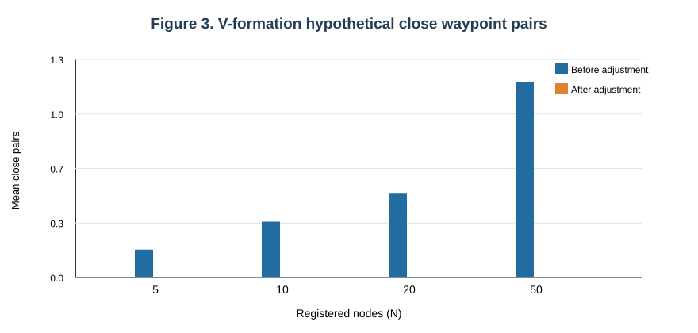
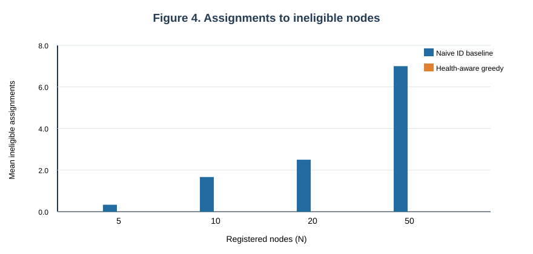
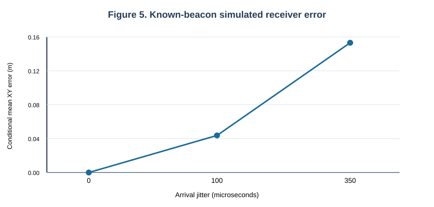

# Reproducible Software Validation of Authenticated UAV Swarm Coordination under Network Faults with Synthetic Acoustic Localization

**Md Shahanur Islam Shagor**  
Voronezh State University of Forestry and Technologies, Voronezh, Russian Federation  
ORCID: 0009-0003-7730-3202  
Corresponding author: Md Shahanur Islam Shagor (submission-system email to be supplied)

## Abstract

Reliable swarm coordination requires authorization of peer commands, predictable responses to communication failures, and reproducible separation of simulated outcomes from field claims. This study evaluates an openly implemented, fixed-membership unmanned aerial vehicle (UAV) swarm software prototype with Ed25519-authenticated membership, AES-256-GCM protected datagrams, quorum-certified leader authority, health-weighted task assignment, geometric formation waypoints and two distinct synthetic acoustic localization modules. The evaluation uses the actual software signing and election routines in a seeded discrete-event packet network, without real radio hardware or physical aircraft. Four fleet sizes (N = 5, 10, 20 and 50) and eight election scenarios are evaluated with six repetitions per setting. The archived GitHub Actions artifact contains 378 per-trial observations across 63 settings, including formation, task-allocation, sound-source, and known-beacon receiver localization scenarios. All six healthy election trials at each fleet size obtained the expected certified leader; near-even partitions produced no quorum certificate in the tested runs. At N = 50, healthy election packet transmissions averaged 9,800 per repetition, illustrating the nontrivial communication scaling of all-to-all signed gossip. Under synthetic acoustic timing jitter, the known-beacon receiver estimator yielded mean conditional XY errors of 0.044 m at 100 microseconds and 0.153 m at 350 microseconds; those values depend on a known synchronized reference frame and are not evidence of autonomous GNSS-denied navigation. We release a reproducibility protocol, raw trials, clearly defined baselines, uncertainty estimates, and descriptive limitations. The demonstrated contribution is inspectable software validation, not formal Byzantine agreement, field-proven localization or flight-safety certification.

**Keywords:** UAV swarm; reproducible simulation; authenticated control; quorum certificate; network partition; Byzantine fault injection; formation waypoints; task allocation; time-difference-of-arrival; software validation.

## 1. Introduction

Unmanned aerial vehicles operating as a cooperating group must communicate, assign responsibilities and withstand partial network or actuator degradation. Contemporary surveys describe diverse coordination architectures but also persistent gaps involving secure group membership, navigation under degraded GNSS, and reliable multi-agent control [1–5]. In adversarial settings, authenticating an instruction is only one requirement: the sender must also hold contemporaneous authority to issue that instruction, and unreachable subgroups must not independently assume global leadership [2,6,7].

The experimental problem addressed here is narrower than safe autonomous flight. A research prototype includes separately executable peer nodes and a simulation-only control adapter. Its default legacy graphical flight-manager path is not equated with the new authenticated protocol. The authenticated path binds per-member signatures to encrypted datagrams, protects against duplicate packets, and requires a signed quorum certificate for command authority. A local formation policy and health-aware greedy task allocator compute waypoints that remain subject to software safety checks. Distinct acoustic modules localize an unknown **sound source** using known sensor coordinates, and a simulated **receiver** using known synchronized beacon locations. These computations cannot be interchanged as evidence that a drone autonomously knows its position without any external reference [4,18,19].

The purpose of this article is to make implementation-to-evidence claims auditable and to test representative failure modes using a stable experiment matrix. A related conference work on acoustic localization was reported previously [24]. The current contribution differs by auditing cryptographic coordination, comparative waypoint and task assignment behavior, cross-platform software tests, and explicit uncertainty handling rather than claiming a new flight-proven acoustic navigation system. No text or figures from that conference item are reproduced here. Related work and any simultaneously submitted swarm-security manuscripts must be disclosed to an editor before submission.

We ask whether (RQ1) the software obtains its expected leader certificate under specified delivery and adversarial scenarios, (RQ2) no leader is certified when quorum is unavailable, (RQ3) the waypoint-separation heuristic reduces hypothetical close waypoint pairs under synthetic perturbation, (RQ4) health-aware assignment avoids ineligible simulated nodes relative to a naive baseline, and (RQ5) synthetic acoustic estimates behave predictably as input noise grows. These are empirical software questions. They do not assert proof of protocol safety under arbitrary Byzantine scheduling or guarantee closed-loop physical flight stability.

## 2. Related work and positioning

Secure UAV-swarm communication has motivated research in dynamic key agreement, physically bound secrets, blockchain-assisted authentication and distributed trust [2,7–9]. Such protocols cover threat surfaces that a fixed, locally provisioned roster does not: online member revocation, compromised-key recovery, dynamic enrollment and adversarial radio channels. The present prototype should not be compared as a cryptographically equivalent substitute for these systems. Recent UAV-swarm Byzantine-defense and denial-of-service papers also examine attacks on learning and control that differ from our authenticated vote injection [6,25–27].

Work on fault-tolerant formation includes distributed model predictive control, Lyapunov analysis, actuator-fault compensation and implemented flight-control techniques [10–14]. Our waypoint-only repulsion calculation lacks those dynamics and guarantees, so its appropriate baseline is the same geometric targets *before adjustment*, not a published closed-loop controller. Studies of multi-robot task allocation propose optimization, auction and temporal methods [15–17]; our deterministic greedy score is evaluated against a deliberately simple node-ID allocator to clarify eligibility behavior. It is not claimed to be globally optimal or superior to state-of-the-art scheduling.

Acoustic ranging and localization have an established signal-processing foundation in generalized cross correlation and time-difference-of-arrival (TDOA) [18,19]. Newer GNSS-denied UAV reviews emphasize that genuine navigation requires reference availability, synchronization, uncertainty management and motion-aware sensor fusion [4]. Our unknown-source experiment uses fixed sensor XY coordinates; our receiver experiment assumes four known beacon XY coordinates and a calibrated emission schedule. Even if satellite data are absent from a solver call, that alone does not validate autonomous GNSS-denied flight.

The authentication primitives used here follow established algorithm specifications rather than introducing new cryptography: Ed25519 signatures [20] and AES-GCM authenticated encryption [21]. Quorum certificates resemble a component of Byzantine replication, but full Byzantine agreement requires additional locking, view-change, state-machine and network assumptions, as illustrated by HotStuff and PBFT [22,23]. We therefore call our software **quorum-certified coordination**, not a formally proven Byzantine-resilient consensus protocol.

## 3. Implemented software architecture

Figure 1 distinguishes authenticated mesh code from the experiment's virtual transport and evidence pipeline. The GitHub repository exposes the authenticated coordination implementation (`swarm_mesh.py`), member and vote persistence (`swarm_identity_store.py`), loopback UDP transport (`swarm_transport.py`), independent-process deployment (`swarm_deployment.py`), formation targets (`swarm_formation.py`), greedy tasks (`swarm_tasks.py`), and an opt-in existing-Drone simulation adapter (`mesh_simulation.py`). The separate legacy `SwarmManager`/GUI controller is not used as cryptographic evidence for the opt-in path. The second evaluation layer adds `swarm_network_experiments.py`, `swarm_geometry_experiments.py`, `swarm_acoustic_experiments.py` and a CSV/JSON experiment runner.

### 3.1 Identity, command authority and fault model

Each registered node holds an Ed25519 key pair. Signed packets carry node identity, boot-session ID, sequence number, protocol epoch and payload; AES-256-GCM provides authenticated transport encryption. A receiver checks known membership, digital signature, freshness window and replay state. Persistent local ballot journals are fsynced before a vote signature is produced. These safeguards limit replay and restart equivocation but do not establish resistance to an adversary that extracts a private key or compromises more than the assumed budget. Membership is fixed and registered out of band.

For a fleet of N nodes, the configured fault budget is f = floor((N - 1) / 3), and a quorum certificate requires q = N - f signatures. The evaluated N values imply (N, f, q) = (5, 1, 4), (10, 3, 7), (20, 6, 14) and (50, 16, 34). This is a chosen signature threshold; it is not itself a proof of asynchronous Byzantine agreement. The multi-criteria suitability score combines normalized battery, motor health and link quality with weights 0.45, 0.35 and 0.20, respectively. A signed certificate binds a candidate and epoch. Expired leader authority is fenced and the simulation adapter refuses direct network-triggered arming. The current security analysis is for a static roster and representative tested packet schedules; adaptive cross-view attacks, malicious health reports and dynamic reconfiguration remain open.

### 3.2 Geometric formation and scheduling

Formation targets support line, V, circle and grid configurations using a specified leader position, heading and spacing. A local neighbor-repulsion heuristic can propose an adjusted waypoint if sampled relative positions are close. A *waypoint pair* with Euclidean separation less than 8 m is counted as a hypothetical proximity violation. This is not a physical collision or a verified collision-free path. We record both proximity and distortion of the original formation references so a lower close-pair count is not presented as cost-free improvement.

Task assignment rejects nodes with battery below 30%, motor health below 75%, or link quality below 40%. Qualified nodes receive tasks through a deterministic greedy function minimizing an explicit travel-distance-plus-health-penalty score, with at most one task per node in these trials. The baseline maps sorted tasks onto sorted node identifiers and ignores health and distance. Straight-line assignment distance is reported in meters and must not be interpreted as actual energy, mission duration or actuator workload.

### 3.3 Two separate acoustic estimators

The unknown-sound-source experiment uses four fixed microphones and generates delayed sampled impulses according to geometric propagation times, with additive synthetic sample noise. Source XY position is estimated from inter-sensor delays using cross correlation and nonlinear least squares. The known-beacon receiver experiment instead generates arrival timestamps from four externally known synchronized beacons plus a common receiver clock offset. Emission schedule correction removes that offset, after which a nonlinear TDOA solver estimates receiver XY. Both experiments use an assumed speed of sound of 343 m/s; neither models rotor noise, reflection, outdoor temperature gradients, moving microphones, receiver attitude, multipath or field clock drift.

## 4. Experimental protocol and reproducibility

All reported numbers in this paper are derived from a successfully completed GitHub Actions evidence archive for repository revision `d7393ba91166acd3b632cbb51a584b5611196edb` with manifest seed 2026, Python 3.11.18 on Linux. It contains 378 raw observations, partitioned into 192 election, 96 formation, 48 allocation, 24 receiver and 18 source-localization rows. These rows cover 63 settings; each setting contains six repeated seeded observations. Subsequent optimization or figure-generation commits must be rerun before mixing their measurements with this archived dataset.

The experiment harness uses the actual signing, decryption, election and certificate validation code, but replaces real UDP transport with a seeded discrete-event packet queue that assigns 1–12 ms *virtual* packet delays. It includes a nominal 15% packet-loss scenario with three signed vote retransmission rounds, signed vote withholding and equivocation, corrupted wire packets, partitioned connectivity, and deliberate simulated leader failure. We log transmitted and delivered packets/bytes, rejected envelopes and observed certificate outcomes. A virtual clock is not an RF round-trip-time measurement; host execution time is not an autopilot command latency.

The geometry experiment uses the repository's formation function and adds Gaussian 3D perturbations with standard deviation 6 m to the waypoint positions, measuring original and adjusted positions. The task experiment uses shared generated positions/tasks for the greedy policy and naive baseline, both with and without approximately 20% degraded members. The synthetic receiver study tests 0, 100 and 350 microseconds of arrival jitter and a no-reference case; sound-source impulses are studied at sample-noise levels 0, 0.02 and 0.05. These are deliberately controlled idealized parameter settings rather than representative flight conditions.

For binary success fractions, we report two-sided 95% Wilson intervals; for continuous observations with at least two values, we use percentile bootstrap confidence intervals with 500 resamples. The intervals describe variability across six sampled synthetic trials; they do not constitute formal hypothesis tests, statistical guarantees under distribution shift, or independent hardware replication. Missing localization estimates are counted but not assigned zero error. The public raw trials.csv, trials.json, summary.json, manifest.json and REPORT.md form the executable evidence boundary. Independent replication must pin code revision, dependency versions, seed and experimental parameters and should report its own confidence intervals.

### Table 1. Experiment matrix

| Subsystem | Conditions | Metric | Evidence boundary |
|---|---|---|---|
| Authenticated election | N = 5, 10, 20, 50; eight fault scenarios; six seeds each | Correct leader certificate; partition refusal; packet count; same-epoch conflict | Virtual datagram schedule; static roster |
| Formation | Four patterns; spacing 12 m; Gaussian 6 m perturbation | Hypothetical close waypoint pairs; geometric reference deviation | No dynamics or physical collision |
| Task allocation | Healthy or 20% degraded; naive ID baseline | Ineligible assignments; task count; Euclidean distance | Not energy/mission completion |
| Known-beacon receiver | Four synchronized anchors; arrival jitter 0/100/350 microseconds; no-reference control | Conditional XY error; success rate | Known frame, simulated clocks |
| Sound-source TDOA | Four known microphones; noise SD 0/0.02/0.05 | Conditional XY error; detection rate | Synthetic impulses, not recorded audio |

## 5. Results

### 5.1 Signed election, fault injection and communication cost

Healthy signed-election convergence was observed in all six trials for every N value. The same tested success count occurred under signed Byzantine vote withholding, equivocation and the nominal 15% packet-loss schedule, but the narrow sample does not establish resilience to arbitrary adversarial scheduling. Each 6/6 success rate has a 95% Wilson interval of approximately 0.610–1.000. Near-even partitions produced no certified honest nodes in all six trials per fleet size; that is **safe non-election**, not successful availability. No same-epoch conflicting certified leader pairs were recorded in the archived schedules, but a zero observed count cannot prove full consensus safety.

Figure 2 distinguishes observed certificate convergence from safety-preserving refusal. Table 2 reports raw event counts and the healthy scenario's mean transmissions per repetition. Transmission cost grew from 80 packets at N = 5 to 9,800 at N = 50 in the tested all-to-all messaging pattern. The virtual clock's failure-recovery scenario includes the programmed leader timeout and event delivery; the observed mean near 5.28 s is therefore NOT a measured real-drone failover delay or a prediction of physical recovery time. It directly contradicts an unsupported 1.2 s field-recovery claim in the legacy manuscript.

### Table 2. Observed election outcomes (six trials per setting)

| N | f | q | Healthy | 15% loss | Withholding | Safe no-certificate, near-even split | Healthy packets per trial |
|---:|---:|---:|---:|---:|---:|---:|---:|
| 5 | 1 | 4 | 6/6 | 6/6 | 6/6 | 6/6 | 80 |
| 10 | 3 | 7 | 6/6 | 6/6 | 6/6 | 6/6 | 360 |
| 20 | 6 | 14 | 6/6 | 6/6 | 6/6 | 6/6 | 1,520 |
| 50 | 16 | 34 | 6/6 | 6/6 | 6/6 | 6/6 | 9,800 |

### 5.2 Formation waypoint geometry

The V-pattern experiment shows that the generated local neighbor-separation adjustments changed the mean close-waypoint-pair count from 0.17, 0.33, 0.50 and 1.17 to 0.00 at N = 5, 10, 20 and 50, respectively, for the six sampled scenes. These are end-point *waypoint comparisons* only; vehicles were not commanded along those paths and the data cannot support collision-rate or flight-stability conclusions. Mean distance from unperturbed reference waypoints did not consistently decrease, emphasizing the distortion–separation trade-off. Figure 3 shows the before/after values.

### 5.3 Greedy task allocation versus an intentionally naive baseline

With approximately 20% simulated nodes below health eligibility thresholds, the naive node-ID assignment selected an average of 0.33, 1.67, 2.50 and 7.00 ineligible node-task pairs for N = 5, 10, 20 and 50, respectively. The implemented eligibility-filtered greedy allocator assigned no tasks to ineligible nodes in those trial sets while still allocating three, seven, fifteen and thirty-seven tasks per run. Mean Euclidean assignment distances were also lower than the naive baseline, but this is an intentionally weak comparator without obstacle-aware routing, fairness or energy modeling. Figure 4 shows health-eligibility outcomes only; it must not be read as proof of superior mission efficiency.

### 5.4 Synthetic acoustic estimates: success and conditional error

Table 3 separates receiver localization from sound-source estimation. The four-known-beacon receiver estimator localized all six samples per jitter condition with a mean conditional XY error of approximately 0.000 m at zero jitter (numerical precision), 0.044 m at 100 microseconds and 0.153 m at 350 microseconds. When the beacon reference was removed, it returned zero successful estimates and no position errors; these were left as missing instead of incorrectly counting them as zero. Sound-source impulse localization detected six of six events at the two lower sample-noise levels; at a noise standard deviation of 0.05 it detected five of six, and among those five detected estimates mean position error was 10.23 m. This counterexample invalidates any unconditional sub-3 m accuracy assertion across noise conditions.

### Table 3. Conditional acoustic localization outcomes (six trials per condition)

| Estimator and condition | Successful | Mean XY error among successful (m) | Important assumption |
|---|---:|---:|---|
| Known-beacon receiver, 0 microseconds jitter | 6/6 | 0.0000 | Known synchronized external XY anchors |
| Known-beacon receiver, 100 microseconds jitter | 6/6 | 0.0437 | Known synchronized external XY anchors |
| Known-beacon receiver, 350 microseconds jitter | 6/6 | 0.1532 | Known synchronized external XY anchors |
| Known-beacon receiver, no reference | 0/6 | Not defined | Missing reference: estimator refuses |
| Sound source, 0.0 sample-noise SD | 6/6 | 0.0019 | Fixed, known microphone XY positions |
| Sound source, 0.02 sample-noise SD | 6/6 | 0.0019 | Fixed, known microphone XY positions |
| Sound source, 0.05 sample-noise SD | 5/6 | 10.2263 | Fixed, known microphone XY positions |

### 5.5 Reproducibility and uncertainty

The 378-row evidence artifact and 63-setting summary were generated by one successful GitHub Actions experiment job and passed its schema checks. The separate application regression suite covers secure communications, basic consensus behavior, simulated fleet control, acoustics and ledger integrity across supported operating systems. Such passing tests verify code behavior under the scripted conditions; neither test counts nor CI status measure deployment reliability. The present six replicates per setting provide exploratory uncertainty intervals only. Reporting the Wilson lower bound for 6/6 success (about 0.610) is a deliberate safeguard against overstating observed reliability. Raw and summary results, their source revision and interpreter/environment metadata are available for reproduction; later changes must be accompanied by a fresh result artifact rather than silently replacing the underlying code revision.

## 6. Discussion, threat model and validity limits

The principal engineering benefit of the implementation is that each authorized action can be related to an authenticated member and an epoch-specific voting certificate. That provenance helps characterize spoofing, replay and crash recovery in software, but the simulated fault injection does not contain an adaptive attacker controlling arbitrary network timings, clock skew, compromised signing keys, or persistent malicious membership. Even an observed zero same-epoch conflict rate gives no formal proof of state-machine consensus [22,23]. Likewise, the healthy fleet's increasing packet count is consistent with all-to-all gossip overhead; stronger scalability claims require algorithmic and network comparisons across a wider workload distribution.

The formation and scheduling modules are useful standalone decision functions. However, waypoint proximity is not a vehicle collision, straight-line travel is not mission energy, and successful assignment is not completed inspection. More appropriate baselines from optimization, auction systems and model predictive control must be implemented before claiming comparative advantage [11–17]. The present naive baseline makes only the limited conclusion that checking node health can prevent assigning work to deliberately ineligible members in the generated cases.

The acoustic module results strongly depend on the chosen sensors, source distribution, impulse synthesis, known beacon emission schedule and bounded noise. Known-anchor localization without a GPS argument to the solver is not the same as externally unaided vehicle localization. Measured source-position error at the highest tested noise level and the no-reference failure case should be retained in any abstract or submission discussion. A field study would need synchronized real microphones, changing acoustic propagation speed, multipath, motor interference, moving anchors, measured clocks, GNSS-denied trajectory truth and uncertainty propagation [4,18,19,24].

Internal-validity threats include seeded virtual delivery distributions that omit adversarial reordering tails; a fixed static roster; and application-level fault injection rather than independent multi-radio deployment. Construct-validity threats concern how virtual milliseconds, waypoint pairs, and modelled health states map to real-world performance. Statistical threats include six repeats, repeated task generation from the same PRNG family, multiple scenario comparisons and bootstrap intervals that do not correct for selection or multiplicity. External validity is limited to the supplied generated scenarios. These limitations should accompany the public artifact and any manuscript submission rather than being moved solely to supplementary material.

The related acoustic conference contribution [24] is acknowledged to avoid ambiguous novelty or duplicate-publication claims. The novel focus of this manuscript is an integrated cryptographic/swarm-software **evaluation protocol** and transparent validation results. It does not claim to introduce the original GCC-PHAT method, Ed25519, AES-GCM, or full Byzantine consensus, nor to reproduce the experimentally richer control architectures cited in the literature.

## 7. Conclusion

An open, opt-in UAV-swarm software prototype was evaluated using real signed election routines and a synthetic event-driven network, geometric waypoint studies, health-filtered task assignments and two independent acoustic localization formulations. The archived six-repeat, 378-observation evidence set covers four fleet sizes up to 50 members. Within the evaluated schedules, healthy election trials obtained certificates, near-even partitions withheld authority, and malicious packet experiments did not produce recorded same-epoch conflicting certified leaders. Formation adjustment reduced hypothetical close waypoint-pair counts and health filtering avoided ineligible task assignments relative to the explicitly naive comparator. Synthetic known-beacon errors increased with arrival jitter, and high source-signal noise produced markedly worse conditional localization error. These outcomes establish reproducible software behavior under declared assumptions; they do not establish field readiness, formal Byzantine consensus safety, or autonomous GNSS-denied flight. Independent testing using real synchronized acoustic captures, realistic comparative controllers and adversarial network models is required for stronger claims.

## Data availability

The exact data source is the GitHub Actions **seeded-swarm-experiment-evidence** artifact for the experimental repository revision `d7393ba91166acd3b632cbb51a584b5611196edb` (manifest date 8 November 2026). The archive includes 378 raw trial rows, per-setting summaries, the manifest and generated report. Repository: https://github.com/smshagor-dev/decentralized-coordination-and-acoustic-localization-in-secure-autonomousa-drone-swarms . The supplementary ZIP delivered with this manuscript preserves the verified experiment archive. The analyses and figures in this manuscript use that archive only; they must be regenerated before substituting a later code revision.

## Code availability

The public repository includes fixed-roster coordination, authenticated transport, acoustic solvers, experiment modules, CI configuration and reproducibility documentation. Run the evidence generator with the seed, fleet sizes, trial counts and dependencies documented in `Docs/SWARM_EXPERIMENT_PROTOCOL.md`. Generated output is expressly labelled software-only. A versioned release tag and persistent data DOI should be assigned **before final journal submission** if required by the chosen journal; neither is invented here.

## Declarations and submission disclosures

- **Ethics approval:** Not applicable to the reported computational simulations; no human participants or animal experiments are represented.
- **Author contributions:** Md Shahanur Islam Shagor: conceptualization, software, experiments, formal analysis, manuscript preparation. To be confirmed before submission.
- **Funding:** Author confirmation required; no funding declaration is inferred.
- **Competing interests:** Author confirmation required; no declaration is inferred.
- **Consent for publication:** To be completed in the selected submission system as applicable.
- **Prior work and overlap:** The related acoustic conference article [24] must be disclosed. Its empirical data and figures are not claimed as new in this paper. Any overlapping swarm-command-authorization manuscript under consideration elsewhere must also be declared to the target editor; simultaneous duplicate submissions are not appropriate.
- **Correspondence and affiliation:** Validate the displayed university affiliation, ORCID and corresponding email against the intended journal's official submission record before sending.

## References

1. Alqudsi Y, Makaraci M. UAV swarms: research, challenges, and future directions. Journal of Engineering and Applied Science. 2025;72:12. https://doi.org/10.1186/s44147-025-00582-3
2. Wang X, Zhao Z, Yi L, et al. A survey on security of UAV swarm networks: attacks and countermeasures. ACM Computing Surveys. 2025;57(3):74. https://doi.org/10.1145/3703625
3. Dimos A, Skoutas DN, Nomikos N, Skianis C. A survey on UxV swarms and the role of artificial intelligence as a technological enabler. Drones. 2025;9(10):700. https://doi.org/10.3390/drones9100700
4. Jarraya I, Al-Batati A, Kadri MB, et al. GNSS-denied unmanned aerial vehicle navigation: analyzing computational complexity, sensor fusion, and localization methodologies. Satellite Navigation. 2025;6:9. https://doi.org/10.1186/s43020-025-00162-z
5. Khargharia HS, Ouali A, Shakya S, Ahmad S. Collision avoidance in UAV swarms: a learning-centric perspective on collaborative intelligence. Neurocomputing. 2026. https://doi.org/10.1016/j.neucom.2025.132020
6. Sophia S, Leelipushpam PGJ, Jebadurai IJ, et al. Zero-trust graph-attentive intelligence for Byzantine-resilient UAV swarms under communication constraints. Discover Electronics. 2026;3:154. https://doi.org/10.1007/s44291-026-00305-9
7. Intelligent UAV swarm key agreement survey: systematic taxonomy, cryptographic automaton and quantum resistance. Internet of Things. 2025;34:101720. https://doi.org/10.1016/j.iot.2025.101720
8. Chen L, Zhu Y, Liu S, Yu H, Zhang B. PUF-based dynamic secret-key strategy with hierarchical blockchain for UAV swarm authentication. Computer Communications. 2024;218:31–43. https://doi.org/10.1016/j.comcom.2024.02.001
9. Blockchain-based lightweight key management scheme for secure UAV swarm task allocation. IEEE Transactions on Network and Service Management. 2025. https://doi.org/10.1109/TNSM.2025.3636562
10. Network analysis of decentralized fault-tolerant UAV swarm coordination in critical missions. Drone Systems and Applications. 2024;12:1–15. https://doi.org/10.1139/dsa-2023-0101
11. Xu B, Dai Y, Suleman A, Shi Y. Distributed fault-tolerant control of multi-UAV formation for dynamic leader tracking: a Lyapunov-based MPC framework. Automatica. 2025;175:112179. https://doi.org/10.1016/j.automatica.2025.112179
12. Hu Y, Miao Z, Wang Y, Zhang H, Wang X, He W. Safe and reliable distributed fault-tolerant formation control for quadrotor swarms. IEEE Transactions on Aerospace and Electronic Systems. 2025;61(4):9220–9234. https://doi.org/10.1109/TAES.2025.3553120
13. Miao Q, Zhang K, Jiang B. Fixed-time collision-free fault-tolerant formation control of multi-UAVs under actuator faults. IEEE Transactions on Cybernetics. 2024;54(6):3679–3691. https://doi.org/10.1109/TCYB.2024.3352251
14. Luo M-M, Wang J. Distributed adaptive event-triggered formation fault-tolerant control for multiple quadrotors. Measurement and Control. 2024. https://doi.org/10.1177/00202940241306656
15. Chakraa H, Guérin F, Leclercq E, Lefebvre D. Optimization techniques for multi-robot task allocation problems: review on the state-of-the-art. Robotics and Autonomous Systems. 2023;168:104492. https://doi.org/10.1016/j.robot.2023.104492
16. Shan X, Jin Y, Jurt M, Li P. A distributed multi-robot task allocation method for time-constrained dynamic collective transport. Robotics and Autonomous Systems. 2024;178:104722. https://doi.org/10.1016/j.robot.2024.104722
17. Athira KA, Udayan JD, Subramaniam U. A systematic literature review on multi-robot task allocation. ACM Computing Surveys. 2024. https://doi.org/10.1145/3700591
18. Shokrollahi M, Tamaddon M. A low-complexity highly accurate sound source localization algorithm based on sound sensor arrays. Journal of Vibration and Control. 2024. https://doi.org/10.1177/10775463241284432
19. Knapp CH, Carter GC. The generalized correlation method for estimation of time delay. IEEE Transactions on Acoustics, Speech, and Signal Processing. 1976;24(4):320–327. https://doi.org/10.1109/TASSP.1976.1162830
20. Josefsson S, Liusvaara I. Edwards-Curve Digital Signature Algorithm (EdDSA). RFC 8032. 2017. https://doi.org/10.17487/RFC8032
21. Dworkin M. Recommendation for Block Cipher Modes of Operation: Galois/Counter Mode (GCM) and GMAC. NIST SP 800-38D. 2007. https://doi.org/10.6028/NIST.SP.800-38D
22. Yin M, Malkhi D, Reiter MK, Gueta GG, Abraham I. HotStuff: BFT consensus with linearity and responsiveness. ACM PODC. 2019:347–356. https://doi.org/10.1145/3293611.3331591
23. Castro M, Liskov B. Practical Byzantine fault tolerance. 3rd USENIX Symposium on Operating Systems Design and Implementation. 1999. https://www.usenix.org/conference/osdi-99/practical-byzantine-fault-tolerance
24. Shkhagor MS, Zarevich AI, Zarevich MA. Acoustic localization for decentralized swarms of unmanned aerial vehicles in the absence of GPS. MIST 2026:1425–1432. [Related conference publication; overlap disclosed]. https://doi.org/10.58168/MIST2026_1425-1432
25. Wang J, Yang C, Zhang C, et al. Byzantine-resilient UAV swarm federated reinforcement learning for low-altitude economy. IEEE Transactions on Vehicular Technology. 2026;75(7):12148–12165. https://doi.org/10.1109/TVT.2026.3652125
26. Detection-guided resilient consensus control for UAV swarms under random denial-of-service attacks. Eng. 2026;7(9):451. https://doi.org/10.3390/eng7090451
27. Federated learning and lightweight blockchain for resilient UAV communication against PNT and model poisoning attacks. IEEE ICTC. 2025. https://doi.org/10.1109/ICTC66702.2025.11388093

## Supplementary methodological audit

The repository's legacy `research_paper.md` contained unverified claims of production-ready flying safety, unconditional meter-level positioning, strong Byzantine fault tolerance, and sub-50 ms control latency. This manuscript intentionally **does not adopt those claims**. Its data lineage is the raw GitHub Actions experiment archive, not the legacy text. Figure 1 is a schematic of the software/test boundary; Figures 2–5 are regenerated from the archived measured software outcomes, with no smoothed or invented series. Readers should consult the full 378-row data table for subgroup denominators and trial-level details.